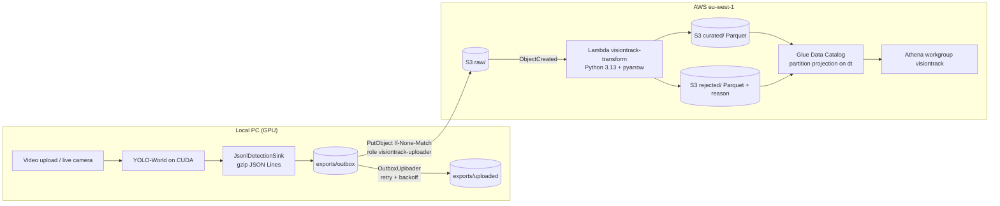

# Hindsight – see what happened, remember what was said

A local Windows app that turns videos and meetings into facts you can search, running entirely on your NVIDIA GPU.

- **Video analysis** – YOLO-World on ONNX Runtime (CUDA) detects and tracks objects, counts each physical object
  once and reports when it was first and last seen; annotated video export and a live camera mode.
- **Meeting notes** – records the screen, your microphone and the other participants (or takes an uploaded
  recording), transcribes it with NVIDIA Parakeet and writes a summary, decisions and action items with a local
  Gemma 4 12B; optional export to Notion.
- **Data pipeline** – detections flow to AWS: S3 → Lambda → Parquet → Athena, all in Terraform.
- **Private by design** – no cloud AI: nothing leaves the computer unless you send it.

**Stack:** Java 21, Spring Boot 3.5, ONNX Runtime (CUDA), FFmpeg/JavaCV with NVENC, whisper.cpp, llama.cpp,
AWS (S3, Lambda, Glue, Athena), Terraform, Python.

## Requirements

* Windows 10/11 and an NVIDIA GPU with driver 528 or newer (12 GB of VRAM for meeting notes). There is no CPU
  fallback: without CUDA the app explains what is missing.
* JDK 21 and Maven; the CUDA 12 runtime and cuDNN 9 for ONNX Runtime (their paths are listed under
  `visiontrack.model.native-preload` in `application.yml`).
* Python with `ultralytics`, once, to export the YOLO model.

## Run locally

```bash
pip install ultralytics
python export_yoloworld.py
powershell -ExecutionPolicy Bypass -File packaging\get-models.ps1
mvn package
java -jar target/visiontrack-object-detection-aws-1.0-SNAPSHOT.jar
```

`export_yoloworld.py` writes `models/yoloworldx-960.onnx` and `models/classes.txt` (edit the class list there).
`get-models.ps1` downloads the meeting models (~13 GB); video analysis works without them. Open
http://localhost:8080 and drop in a video. Settings live in `src/main/resources/application.yml`.

The project started as VisionTrack: the Java package, the `visiontrack.*` settings and the data folders
(`Documents\VisionTrack`, `%LOCALAPPDATA%\VisionTrack`) still use that name.

## REST API

| Method | Path                  | Description                                                    |
|--------|-----------------------|----------------------------------------------------------------|
| POST   | `/api/analyses`       | multipart field `file` → `202 Accepted`, job JSON + `Location` |
| GET    | `/api/analyses/{id}`  | status (`QUEUED`, `PROCESSING`, `COMPLETED`, `FAILED`), progress, result |
| GET    | `/api/analyses`       | all jobs, newest first                                         |
| GET    | `/actuator/health`    | health check for load balancers                                |

```bash
curl -F "file=@street.mp4" http://localhost:8080/api/analyses
curl http://localhost:8080/api/analyses/<id>
```

Completed result (shortened):

```json
{
  "totalObjects": 8,
  "counts":  [{ "label": "person", "count": 4, "firstSeen": "00:00:02.000" }],
  "objects": [{ "id": 1, "label": "person", "firstSeen": "00:00:02.000", "lastSeen": "00:00:04.800",
                "visibleSeconds": 2.8, "confidence": 0.903, "box": { "x": 403, "y": 266, "width": 133, "height": 336 } }]
}
```

### Meetings (Windows, local requests only)

| Method | Path                              | Description                                               |
|--------|-----------------------------------|-----------------------------------------------------------|
| GET    | `/api/meetings/devices`           | monitors and microphones (`?refresh=true` probes again)   |
| POST   | `/api/meetings/start`             | `{"title", "monitor", "microphone"}` → starts recording   |
| POST   | `/api/meetings/{id}/stop`         | stops, builds `recording.mp4` (screen + sound) and starts processing |
| GET    | `/api/meetings`, `/api/meetings/{id}` | recorded meetings (read from their folders)           |
| POST   | `/api/meetings/import`            | multipart `file`: an audio or video recording to process like a meeting |
| POST   | `/api/meetings/{id}/process`      | runs the processing again                                 |
| GET    | `/api/meetings/{id}/notes`        | the notes (`notes.md`)                                    |
| GET    | `/api/meetings/{id}/transcript`   | the transcript (`transcript.md`)                          |
| GET    | `/api/meetings/{id}/recording`    | the screen recording with sound, playable in the browser  |
| POST   | `/api/meetings/{id}/open-folder`  | opens the meeting folder in Explorer                      |
| GET    | `/api/meetings/notion`            | whether the Notion export is set up (never the token)     |
| POST   | `/api/meetings/{id}/notion`       | sends the notes to Notion in the background; a page sent before is replaced |

Recordings go to `Documents\VisionTrack\Meetings\<date>_<time>_<title>\`.

* **Recording** – the screen (ffmpeg `ddagrab`, falling back to `gdigrab`, 30 fps, NVENC), the microphone and
  the system sound (WASAPI loopback helper) are captured in separate ffmpeg processes, in 5-minute parts, so a
  crash keeps what was recorded. The screen is only for rewatching; the notes come from what was said.
* **Speech** – Silero VAD finds the speech and NVIDIA Parakeet TDT 0.6B v3 (ONNX Runtime on CUDA) transcribes it
  as "Me" and "Other participants", with punctuation; echoes of the speakers in the microphone are removed.
  Whisper large-v3-turbo (whisper.cpp) is the backup: it takes the pieces Parakeet writes in Cyrillic, runs when
  Parakeet is not installed, and handles everything with `visiontrack.meetings.speech-engine: whisper`.
  A 74-minute recording took 50 s with Parakeet and 2 min 23 s with Whisper.
* **Notes** – Gemma 4 12B on llama.cpp writes `notes.md` and `notes.json`: summary, decisions, action items with
  owners and due dates, timeline and open questions.
* The models run one after another on the GPU and are freed after each step. Without them meetings are still
  recorded; only the transcript or the notes are skipped.

#### Notes in Notion (optional)

A processed meeting can be sent to Notion ("Send to Notion" in the meeting's menu): a page in a "Meetings" database
with the properties Name, Date, Duration (min), Type, Project, Tags and Participants, and a body with the summary,
decisions, action items as to-dos, the timeline, open questions and the transcript in a section that opens on
click. Only these notes leave the computer, and only when you send them.

1. Create an internal integration at [notion.so/profile/integrations](https://www.notion.so/profile/integrations)
   with the capabilities to read, insert and update content, and copy its token.
2. In Notion, open the page that should hold the database: `•••` → Connections → add the integration.
3. Create `%LOCALAPPDATA%\VisionTrack\settings.json` (read on every send, no restart needed):

   ```json
   {
     "notion": {
       "token": "<the integration token>",
       "parentPageId": "<link of that page>",
       "autoExport": false
     }
   }
   ```

The first send creates the database in that page and writes its `databaseId` and `dataSourceId` into the file
(to use a database of your own instead, put its link into `databaseId`; its columns must have the names and types
above). `autoExport: true` sends every meeting after processing. Sending again writes a new page and moves the old
one to Notion's trash. The file holds a secret: it is in `.gitignore`, and the app never logs it. Notion API version
`2026-03-11`; requests are spaced to stay under Notion's limit of about three per second and retried on `429`.

## How it works

```
upload ─► VideoStorage ─► job queue ─► VideoAnalyzer
                                         ├─ VideoReader (FFmpeg)       decode, sample N fps
                                         ├─ OnnxYoloDetector (YOLO)    letterbox → infer → NMS
                                         └─ ObjectTracker (IoU)        one track = one counted object
```

| Package       | Responsibility                                               |
|---------------|--------------------------------------------------------------|
| `web`         | REST controller, error responses                             |
| `job`         | job lifecycle, background execution, `JobRepository`         |
| `analysis`    | orchestrates a video run, builds the result                  |
| `detection`   | ONNX Runtime YOLO detector (CUDA only)                       |
| `tracking`    | links detections across frames                               |
| `video`       | FFmpeg decoding and encoding                                 |
| `storage`     | where uploads are kept (`VideoStorage`)                      |
| `meeting`     | recording, speech recognition, notes, Notion export          |
| `export`      | detection events as JSON Lines, outbox, optional S3 upload   |

### Tuning the count

* `analysis.sample-fps` – frames analysed per second of video (higher = more accurate, slower).
* `analysis.track-max-gap-seconds` – how long an object may be hidden and still be the same object.
* `analysis.track-min-hits` – detections needed before something counts (filters one-frame mistakes).
* Overlapping synonyms in `classes.txt` (e.g. `shoe`/`sneaker`, `cup`/`mug`, `hat`/`cap`) can make
  YOLO-World report the same thing twice – keep the class list free of near-duplicates.

## Cloud data pipeline

Video processing stays on the local NVIDIA GPU. Only **structured detection data** (no video, no images)
can be sent to AWS, where it is cleaned, typed and stored as Parquet for SQL queries in Athena.
No GPU and no AI service is used in AWS.



### What is exported

Every run writes two kinds of files to `data/exports` (desktop app: `%LOCALAPPDATA%\VisionTrack\exports`),
whether or not the cloud export is enabled:

| File | Content |
|---|---|
| `detections/dt=YYYY-MM-DD/run_id=<uuid>/part-NNNN.jsonl.gz` | one `DetectionEvent` per line: `schema_version`, `run_id`, `video_id`, `frame_index`, `timestamp_ms`, `class_label`, `confidence`, `bbox_x/y/width/height` (0..1 of the frame), `frame_width`, `frame_height`, `model_name`, `model_version` (SHA-256 prefix of the model file), `detected_at` (UTC ISO-8601) |
| `runs/dt=YYYY-MM-DD/run_id=<uuid>/run.json` | `VideoRunSummary`: `source` (`upload` / `live_camera`), `duration_ms`, `fps`, `total_frames`, `total_detections`, `requested_classes`, `processing_time_ms`, `started_at`, `finished_at`, `app_version`, `status` (`completed` / `failed` / `cancelled`) |

An uploaded video gives one part per run. A live camera session gives a part every
`visiontrack.export.live-batch-seconds` (10 s) and ends when the camera is stopped or after
`live-idle-timeout-seconds` (60 s) without frames. Files move `in-progress/` → `outbox/` → `uploaded/`.
`schema_version` starts at 1; the Lambda rejects versions it does not know.

The outbox mirrors the S3 layout, so the object key is fixed by the run id. Uploads use a conditional PUT
(`If-None-Match: *`): a file sent twice never produces a second copy. Failed uploads wait 5 s, 10 s, 20 s …
up to 15 min; the app keeps working offline and the outbox drains when the connection is back.

### Cleaning rules (Lambda)

* types are cast (numeric strings → numbers, ISO time → `timestamp`), `class_label` is trimmed and lowercased;
* rejected with a `reject_reason`: invalid JSON, missing fields, unknown `schema_version`, `confidence` or
  bbox outside 0..1 (or `x + width > 1`), bad UUID / time, unknown `source` / `status`;
* duplicates by `(run_id, frame_index, class_label, bbox)` are dropped;
* output keys come from the input key (`curated/detections/dt=…/run_id=<uuid>-part-NNNN.parquet`), so a
  repeated S3 event overwrites the same object.

Tests: `cd infra/lambda && python -m venv .venv && .venv/Scripts/pip install -r requirements-dev.txt &&
.venv/Scripts/python -m pytest tests`.

### Set up

Requirements: AWS CLI v2, Terraform ≥ 1.9, a named profile with admin rights in the target account (here `main`, set up with `aws configure --profile main`).

```bash
cd infra
cp terraform.tfvars.example terraform.tfvars   # set budget_email
terraform init
terraform plan -out tfplan                     # review
terraform apply tfplan
terraform output uploader_profile_snippet      # paste into ~/.aws/config
```

The created resources:

* S3 bucket `visiontrack-datalake-<account>-eu-west-1` with public access blocked, SSE-S3, versioning,
  TLS only, lifecycle rules (old versions 30 days, `athena-results/` 7 days, `rejected/` 90 days, `raw/` →
  Standard-IA after 90 days);
* Lambda `visiontrack-transform` with the managed AWS SDK for pandas layer, triggered by `raw/`;
* Glue database `visiontrack` with tables `detections`, `runs`, `rejected` (no crawlers, partition projection);
* Athena workgroup `visiontrack` (own result location, 1 GB scan limit per query) with the example queries;
* IAM: role `visiontrack-uploader` may only `PutObject` under `raw/`; the Lambda role may only read `raw/`
  and write `curated/` and `rejected/`;
* AWS Budgets: monthly 10 USD budget, e-mails at 5 and 10 USD actual spend.

### Enable the export in the app

The export is **off by default**. Turn it on with the `aws` Spring profile; credentials come from the AWS
default chain, never from the project:

```powershell
$env:VISIONTRACK_AWS_PROFILE = "visiontrack-uploader"
$env:VISIONTRACK_CLOUD_BUCKET = "visiontrack-datalake-<account>-eu-west-1"
java -jar target/visiontrack-object-detection-aws-1.0-SNAPSHOT.jar --spring.profiles.active=aws
```

`VISIONTRACK_AWS_PROFILE` names a profile in `~/.aws/config`; without it the default chain is used
(`AWS_PROFILE`, then the `default` profile, which may be a different account).

**Desktop app (`Hindsight.exe`).** The exe reads an optional per-user file
`%LOCALAPPDATA%\VisionTrack\application.yml` on start. Create it with:

```yaml
visiontrack:
  cloud:
    export:
      enabled: true
      bucket: visiontrack-datalake-<account>-eu-west-1
      profile: visiontrack-uploader
```

Then quit the app from the tray icon and start it again. The log
(`%LOCALAPPDATA%\VisionTrack\visiontrack.log`) shows `Cloud export on: outbox uploads to s3://...`, and
finished runs get the cloud badge in the UI. Delete the file (or set `enabled: false`) to turn the export off.
The `~/.aws` profiles must exist on that PC, so this is for the developer's machine, not for a shared build.

Files already in the outbox (exported while the cloud export was off) are uploaded too.

### Query

Open Athena, choose the workgroup `visiontrack` and run the saved queries from
[`analytics/queries`](analytics/queries): detections per class, average confidence per class, detections
per run, rejected records by reason. From the CLI:

```bash
aws athena start-query-execution --work-group visiontrack --profile main \
    --query-string "$(cat analytics/queries/detections_per_class.sql)"
```

### Cost

At student volumes (a few MB per month) the pipeline costs well under 0.10 USD per month: S3 storage and
requests are cents, the Lambda and the Glue Data Catalog stay in the free tier, Athena charges 5 USD per TB
scanned (10 MB minimum per query) and the 1 GB cutoff caps any single query. The budget alerts catch surprises.

### Tear down

```bash
cd infra
aws s3 rm s3://<bucket> --recursive --profile main   # current objects
terraform apply -var force_destroy_bucket=true          # lets Terraform delete the remaining versions
terraform destroy
```

Then remove the `visiontrack-uploader` profile from `~/.aws/config`.

### Next steps

Meeting-notes data in the lake, dbt models on top of `curated/`, a dashboard (QuickSight or Grafana),
streaming with Kinesis Data Firehose instead of files, a remote Terraform state, and GPU deployment of the
analysis itself.
