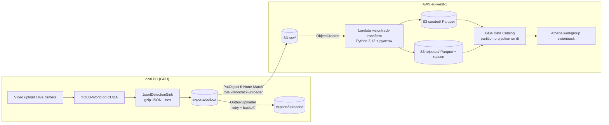

# Cloud data pipeline (AWS)

Video processing stays on the local NVIDIA GPU. Only **structured detection data** (no video, no images)
can be sent to AWS, where it is cleaned, typed and stored as Parquet for SQL queries in Athena.
No GPU and no AI service is used in AWS.



## What is exported

Every run writes two kinds of files to `data/exports` (desktop app: `%LOCALAPPDATA%\VisionTrack\exports`),
whether or not the cloud export is enabled:

| File | Content |
|---|---|
| `detections/dt=YYYY-MM-DD/run_id=<uuid>/part-NNNN.jsonl.gz` | one `DetectionEvent` per line: `schema_version`, `run_id`, `video_id`, `frame_index`, `timestamp_ms`, `class_label`, `confidence`, `bbox_x/y/width/height` (0..1 of the frame), `frame_width`, `frame_height`, `model_name`, `model_version` (SHA-256 prefix of the model file), `detected_at` (UTC ISO-8601) |
| `runs/dt=YYYY-MM-DD/run_id=<uuid>/run.json` | `VideoRunSummary`: `source` (`upload` / `live_camera`), `duration_ms`, `fps`, `total_frames`, `total_detections`, `requested_classes`, `processing_time_ms`, `started_at`, `finished_at`, `app_version`, `status` (`completed` / `failed` / `cancelled`) |

An uploaded video gives one part per run. A live camera session gives a part every
`visiontrack.export.live-batch-seconds` (10 s) and ends when the camera is stopped or after
`live-idle-timeout-seconds` (60 s) without frames. Files move `in-progress/` → `outbox/` → `uploaded/`.
`schema_version` starts at 1; the Lambda rejects versions it does not know.

The outbox mirrors the S3 layout, so the object key is fixed by the run id. Uploads use a conditional PUT
(`If-None-Match: *`): a file sent twice never produces a second copy. Failed uploads wait 5 s, 10 s, 20 s …
up to 15 min; the app keeps working offline and the outbox drains when the connection is back.

## Cleaning rules (Lambda)

* types are cast (numeric strings → numbers, ISO time → `timestamp`), `class_label` is trimmed and lowercased;
* rejected with a `reject_reason`: invalid JSON, missing fields, unknown `schema_version`, `confidence` or
  bbox outside 0..1 (or `x + width > 1`), bad UUID / time, unknown `source` / `status`;
* duplicates by `(run_id, frame_index, class_label, bbox)` are dropped;
* output keys come from the input key (`curated/detections/dt=…/run_id=<uuid>-part-NNNN.parquet`), so a
  repeated S3 event overwrites the same object.

Tests: `cd infra/lambda && python -m venv .venv && .venv/Scripts/pip install -r requirements-dev.txt &&
.venv/Scripts/python -m pytest tests`.

## Set up

Requirements: AWS CLI v2, Terraform ≥ 1.9, a named profile with admin rights in the target account (here `main`, set up with `aws configure --profile main`).

```bash
cd infra
cp terraform.tfvars.example terraform.tfvars   # set budget_email
terraform init
terraform plan -out tfplan                     # review
terraform apply tfplan
terraform output uploader_profile_snippet      # paste into ~/.aws/config
```

The created resources:

* S3 bucket `visiontrack-datalake-<account>-eu-west-1` with public access blocked, SSE-S3, versioning,
  TLS only, lifecycle rules (old versions 30 days, `athena-results/` 7 days, `rejected/` 90 days, `raw/` →
  Standard-IA after 90 days);
* Lambda `visiontrack-transform` with the managed AWS SDK for pandas layer, triggered by `raw/`;
* Glue database `visiontrack` with tables `detections`, `runs`, `rejected` (no crawlers, partition projection);
* Athena workgroup `visiontrack` (own result location, 1 GB scan limit per query) with the example queries;
* IAM: role `visiontrack-uploader` may only `PutObject` under `raw/`; the Lambda role may only read `raw/`
  and write `curated/` and `rejected/`;
* AWS Budgets: monthly 10 USD budget, e-mails at 5 and 10 USD actual spend.

## Enable the export in the app

The export is **off by default**. Turn it on with the `aws` Spring profile; credentials come from the AWS
default chain, never from the project:

```powershell
$env:VISIONTRACK_AWS_PROFILE = "visiontrack-uploader"
$env:VISIONTRACK_CLOUD_BUCKET = "visiontrack-datalake-<account>-eu-west-1"
java -jar target/visiontrack-object-detection-aws-1.0-SNAPSHOT.jar --spring.profiles.active=aws
```

`VISIONTRACK_AWS_PROFILE` names a profile in `~/.aws/config`; without it the default chain is used
(`AWS_PROFILE`, then the `default` profile, which may be a different account).

**Desktop app (`Hindsight.exe`).** The exe reads an optional per-user file
`%LOCALAPPDATA%\VisionTrack\application.yml` on start. Create it with:

```yaml
visiontrack:
  cloud:
    export:
      enabled: true
      bucket: visiontrack-datalake-<account>-eu-west-1
      profile: visiontrack-uploader
```

Then quit the app from the tray icon and start it again. The log
(`%LOCALAPPDATA%\VisionTrack\visiontrack.log`) shows `Cloud export on: outbox uploads to s3://...`, and
finished runs get the cloud badge in the UI. Delete the file (or set `enabled: false`) to turn the export off.
The `~/.aws` profiles must exist on that PC, so this is for the developer's machine, not for a shared build.

Files already in the outbox (exported while the cloud export was off) are uploaded too.

## Query

Open Athena, choose the workgroup `visiontrack` and run the saved queries from
[`analytics/queries`](../analytics/queries): detections per class, average confidence per class, detections
per run, rejected records by reason. From the CLI:

```bash
aws athena start-query-execution --work-group visiontrack --profile main \
    --query-string "$(cat analytics/queries/detections_per_class.sql)"
```

## Cost

At student volumes (a few MB per month) the pipeline costs well under 0.10 USD per month: S3 storage and
requests are cents, the Lambda and the Glue Data Catalog stay in the free tier, Athena charges 5 USD per TB
scanned (10 MB minimum per query) and the 1 GB cutoff caps any single query. The budget alerts catch surprises.

## Tear down

```bash
cd infra
aws s3 rm s3://<bucket> --recursive --profile main   # current objects
terraform apply -var force_destroy_bucket=true          # lets Terraform delete the remaining versions
terraform destroy
```

Then remove the `visiontrack-uploader` profile from `~/.aws/config`.

## Next steps

Meeting-notes data in the lake, dbt models on top of `curated/`, a dashboard (QuickSight or Grafana),
streaming with Kinesis Data Firehose instead of files, a remote Terraform state, and GPU deployment of the
analysis itself.
